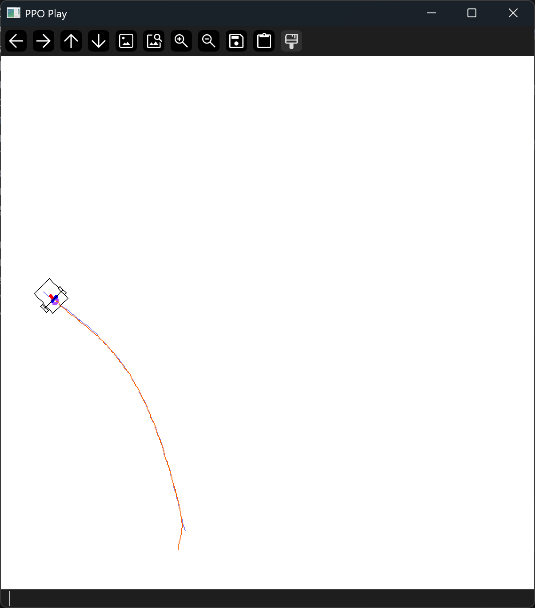
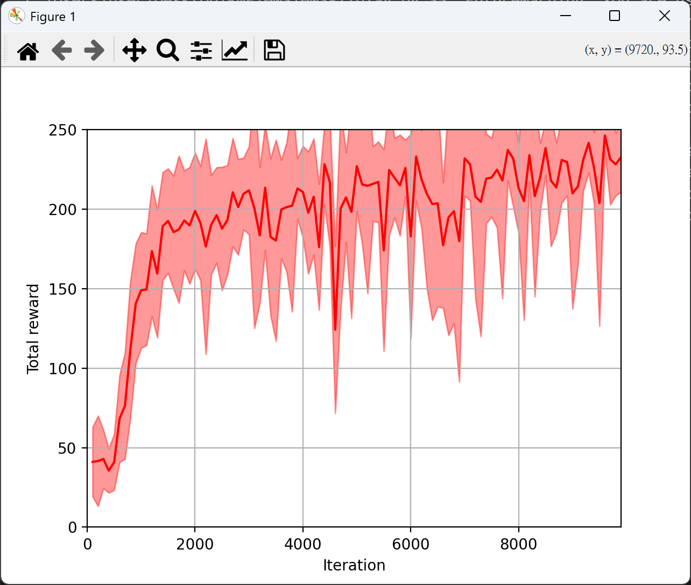
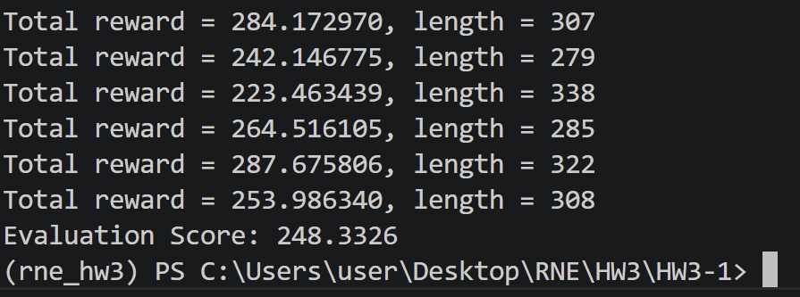
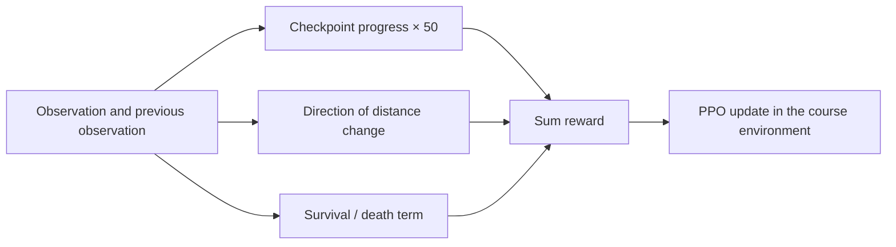

# Reinforcement Learning for Robotic Navigation

**PPO implementation and reward-design experiments from Robotic Navigation and Exploration.**

Two course assignments examine different parts of learning-based control: implementing PPO for simulated path tracking, then designing rewards for checkpoint navigation. My work includes the assigned network/loss/rollout components, parameter tuning, and analysis of the behavior induced by the navigation reward.

| PPO path tracking | Archived training curve |
|---|---|
|  |  |

These images belong to **HW3-1**. They do not evaluate the reward changes in HW3-2.

## 1. PPO path tracking

Within the supplied training framework, I completed the policy and value networks, rollout collection steps, and clipped policy-gradient loss. The policy uses two 64-unit ReLU hidden layers and a diagonal Gaussian action distribution; the value network has a scalar output.

| Setting | Submitted `train.py` |
|---|---:|
| Parallel environments | 8 |
| Rollout steps per environment | 512 |
| Learning rate | 0.0003 |
| Update epochs | 10 |
| Action standard deviation | 0.3 |
| Discount / GAE lambda | 0.99 / 0.95 |
| PPO clipping parameter | 0.2 |

The report's tuning discussion records action standard deviation **0.2**, while the submitted file contains **0.3**. The exact configuration that produced each archived image is not established by the available files.

The report includes an evaluation screenshot displaying **248.3326** and several episode-return examples. This is one archived evaluation output, without a repeated-seed comparison. The original logged iteration/mean-return/standard-deviation values are preserved in [return.txt](archive/HW3-1/save/return.txt); those columns are identified by the writer in `train.py`.

## 2. Checkpoint navigation: reward shapes behavior

The HW3-2 report describes circling and local oscillation when a highly weighted distance-difference reward dominated progress through checkpoints. I revised the distance component to give a bounded direction-of-progress signal and used checkpoint progress as the primary reward.

| Component | Submitted reward |
|---|---|
| Checkpoint progress | `50 * (checkpoint_index - previous_checkpoint_index)` |
| Distance shaping | `+1` when closer, `-1` when farther, `0` when unchanged |
| Survival | `+0.01` while alive; `-100` when dead |

The design intent was to reduce sensitivity to distance magnitude and keep checkpoint passage central. The report records the motivation and observed failure behavior; it does not provide a controlled before/after success-rate or training-curve comparison. See [the reward design case study](docs/reward-design.md).

## Code and contribution

- [HW3-1](archive/HW3-1): submitted PPO, networks, runner and training code, plus the return log.
- [HW3-2](archive/HW3-2): submitted reward/training integration and playback file.
- [Source index](docs/source-index.md): origin of the figures, observations and parameter values.

The environments and surrounding assignment frameworks were supplied by the course. The archive preserves the submitted files unchanged; it is a portfolio of the implementation and analysis within those frameworks. This work is separate from the [ROS2 mission stack](https://github.com/RICHKUNG/ros2-autonomous-pick-and-place), whose deployed mission logic is not presented as an RL policy.

Related: [Motion Planning & Vehicle Control](https://github.com/RICHKUNG/motion-planning-and-control).
